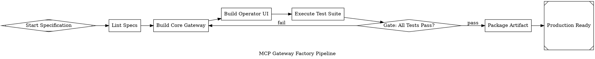

# MCP Gateway & Reverse Proxy

> High-performance reverse proxy, tool aggregator, load balancer, and health monitor for Model Context Protocol (MCP) servers.

[](https://www.python.org/downloads/)
[](https://modelcontextprotocol.io/)
[](https://fastapi.tiangolo.com)
[](https://opensource.org/licenses/MIT)

---

## ⚡ Overview

Connecting LLMs to dozens of separate MCP servers creates configuration sprawl, high connection overhead, and complex client-side routing.

**MCP Gateway** provides a unified reverse proxy and multiplexer:
- **Universal Endpoint (`/mcp/aggregate`)**: Exposes all registered upstream tools under a single standard MCP JSON-RPC 2.0 interface.
- **Dynamic Routing**: Automatically matches `tools/call` requests by tool name and proxies them to the correct upstream server.
- **Direct Server Proxy (`/mcp/{server_id}`)**: Targeted forwarding with latency and error tracking.
- **Live Health Monitoring**: Exponential moving average (EMA) latency tracking, error counting, and automatic status updates.
- **Principal Access Boundaries & HITL Governance**: Priority-ordered tool access policies matching `X-Agent-Principal` Agent Identities against server/tool glob patterns, `DRY_RUN` vs `ENFORCED` audit modes, and HMAC-SHA256 `X-Approval-Token` Human-in-the-Loop gating evaluated prior to cache lookup.
- **Streamable HTTP Session Lifecycle**: `Mcp-Session-Id` negotiation on `initialize` and `202 Accepted` handling for `notifications/initialized`.
- **Interactive Light/Dark Dashboard**: Human-centered operator console with an interactive tool tester and real-time node stats.
- **Factory Provenance**: Engineered with the [Attractor Software Factory](https://github.com/akmalkhaniub/attractor-factory) DOT pipeline specification (`pipeline.dot`).

---

## 🏗️ Architecture

```
                    ┌─────────────────────────┐
                    │       LLM Client        │
                    │ (Claude, Antigravity)   │
                    └───────────┬─────────────┘
                                │ JSON-RPC 2.0
                                ▼
         ┌────────────────────────────────────────────────┐
         │             MCP Gateway (FastAPI)              │
         │  ┌───────────────────┬──────────────────────┐  │
         │  │  /mcp/aggregate   │   /mcp/{server_id}   │  │
         │  └─────────┬─────────┴──────────┬───────────┘  │
         │            │                    │              │
         │     Tool Router & EMA Metrics Tracker          │
         └────────────┬────────────────────┬──────────────┘
                      │                    │
          ┌───────────▼───────────┐ ┌──────▼─────────────────┐
          │ Attractor Factory MCP │ │ Code Analysis / Git MCP│
          │  (DOT Lint, Run, etc) │ │ (Custom Upstream Nodes) │
          └───────────────────────┘ └────────────────────────┘
```

---

## 🚀 Quickstart

### 1. Installation

Install and run locally using [`uv`](https://github.com/astral-sh/uv):

```bash
git clone https://github.com/akmalkhaniub/mcp-gateway.git
cd mcp-gateway

# Sync dependencies and run the server
uv sync --extra dev
uv run uvicorn gateway.server:app --host 127.0.0.1 --port 8080 --reload
```

### 2. Access the Operator Dashboard

Open your browser at [http://127.0.0.1:8080](http://127.0.0.1:8080).
- Toggle between Light and Dark themes.
- View connected upstream nodes and their average latencies.
- Test aggregated tool executions interactively.

---

## 📡 API Endpoints

| Endpoint | Method | Description |
|---|---|---|
| `/health` | `GET` | Service status, server counts, total tools, and cache stats |
| `/api/servers` | `GET` | List all registered upstream servers and live stats |
| `/api/servers` | `POST` | Register a new upstream MCP server |
| `/api/servers/{id}` | `DELETE` | Deregister an upstream MCP server |
| `/api/servers/probe` | `POST` | Trigger immediate concurrent health probe across all upstreams |
| `/api/tools` | `GET` | Aggregated catalog of all available tools |
| `/api/cache/stats` | `GET` | Semantic response cache hits, misses, and hit ratio |
| `/api/cache/clear` | `POST` | Invalidate all cached tool responses |
| `/api/policies` | `GET` / `POST` | List or upsert Principal Access & HITL tool governance policies |
| `/api/policies/{id}` | `DELETE` | Remove a tool governance policy |
| `/api/policies/approval-token` | `POST` | Issue an HMAC-SHA256 scoped `X-Approval-Token` for HITL-gated tools |
| `/api/audit/logs` | `GET` | Query recent governance & tool execution audit trail |
| `/mcp/aggregate` | `POST` | Universal MCP JSON-RPC 2.0 endpoint with policy enforcement & semantic caching |
| `/mcp/{server_id}` | `POST` | Direct proxy to a specific upstream MCP server |
| `/` | `GET` | Interactive HTML5 operator dashboard |
| `/docs` | `GET` | Interactive OpenAPI / Swagger UI documentation |

---

## 🧪 Testing & Verification

Run the comprehensive pytest suite:

```bash
uv run --extra dev pytest tests -v
```

All 7 test suites verify:
- Health check endpoints
- Server registration and dynamic discovery
- Tool aggregation across multiple providers
- JSON-RPC `initialize`, `ping`, `tools/list`, and `tools/call` routing
- Graceful error responses (`-32601` Method/Tool not found, `-32700` JSON parse error)
- Dashboard template rendering

---

## 📄 Attractor Pipeline Specification

This service was engineered using an Attractor Software Factory pipeline (`pipeline.dot`):



---

## ⚖️ License

MIT License. Designed and built with Google Antigravity & the Attractor Software Factory.
